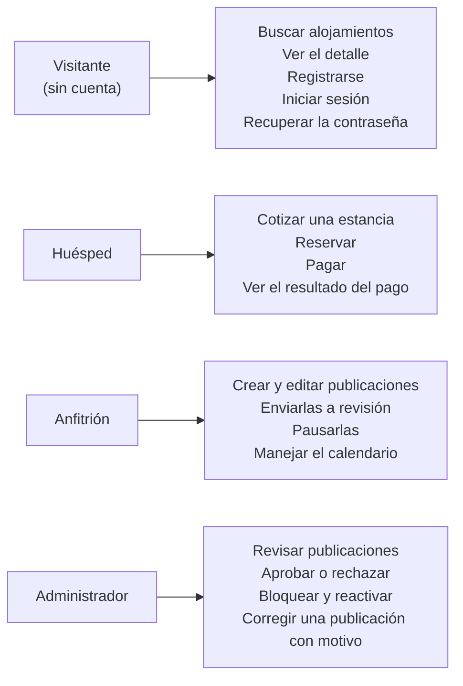
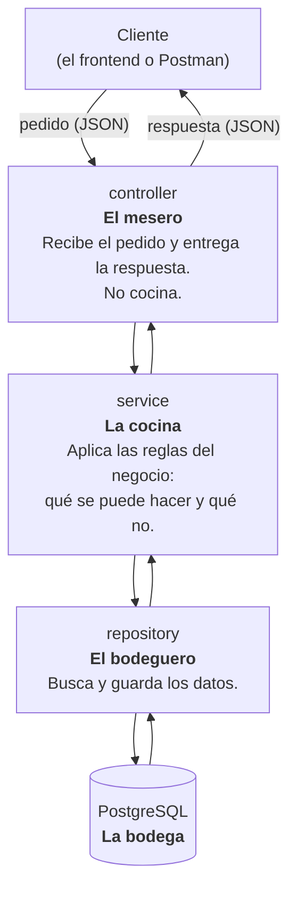
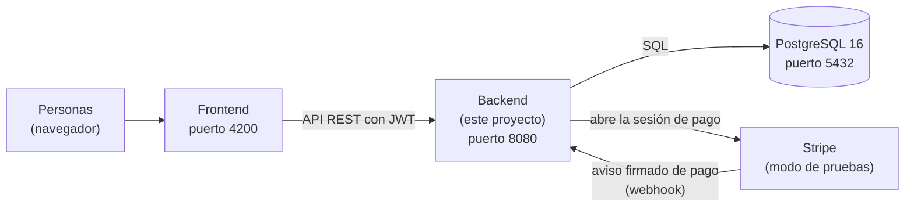
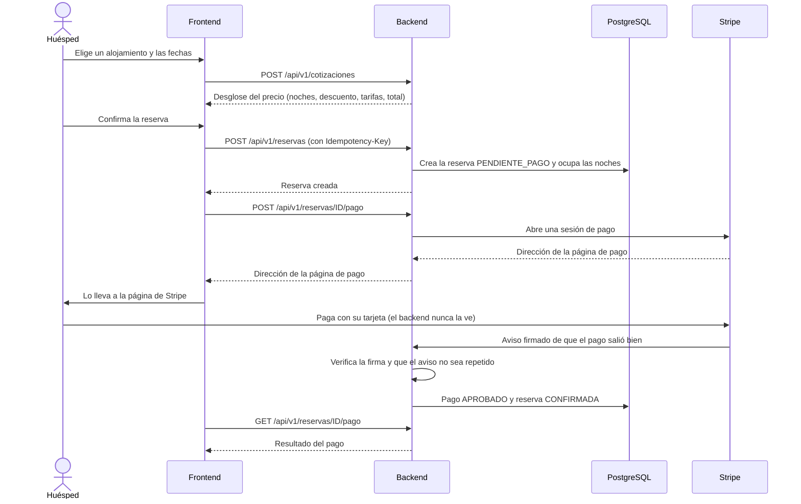
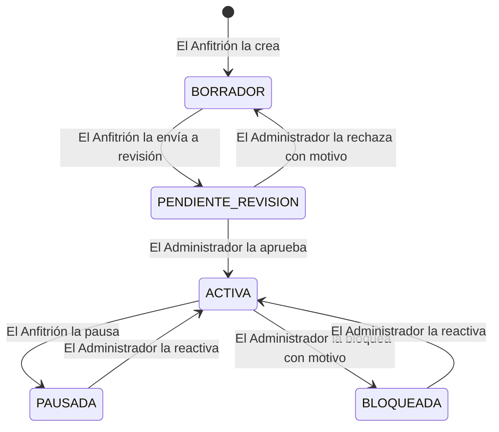
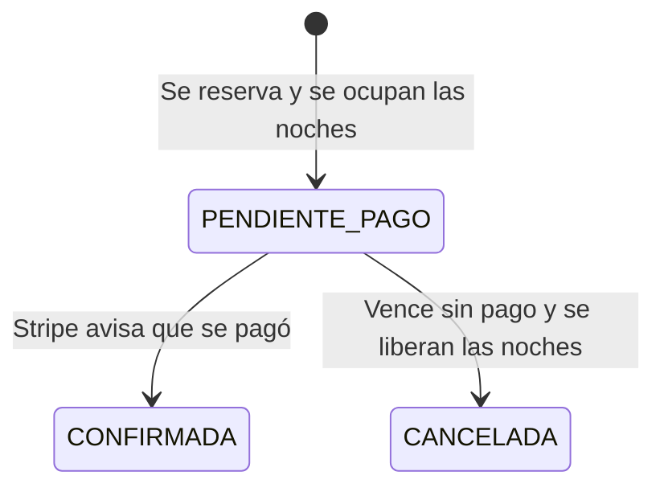
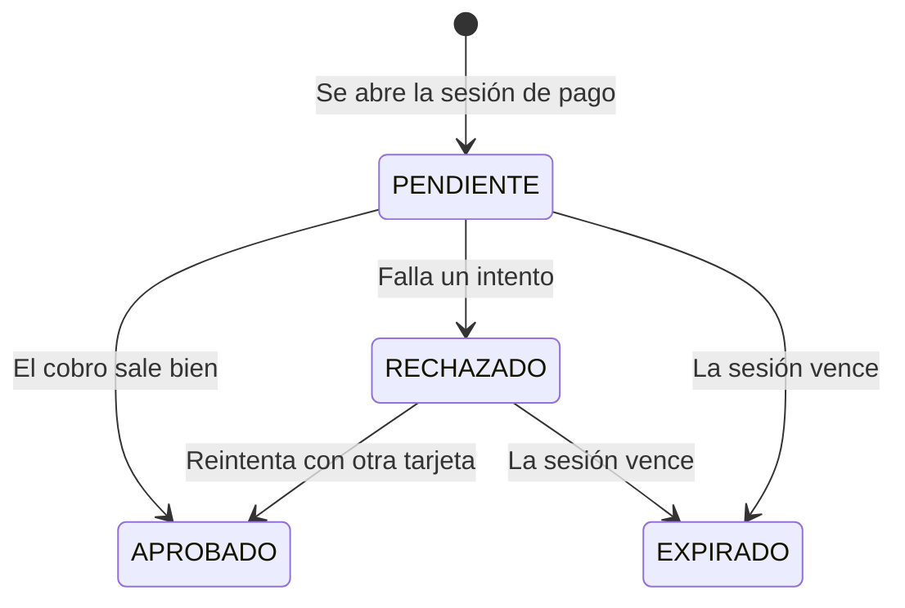
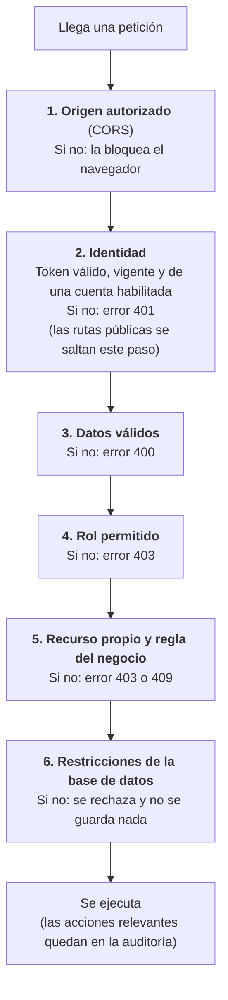

# Inversiones LR — Backend del Marketplace de Alojamientos

El servidor (API) que hace funcionar el marketplace: guarda las cuentas, las publicaciones de alojamientos, su calendario, las reservas y los pagos. Esta guía explica **qué problema resuelve**, **cómo está construido**, **qué medidas de seguridad tiene** y **cómo ponerlo a funcionar en tu computador**, sin dar nada por sabido.

> [!NOTE]
> Los pagos funcionan **solo en modo de pruebas** de Stripe: no se cobra dinero real. Una clave real (`sk_live_...`) impide que la aplicación arranque.

## Contenido

1. [El problema que resuelve](#1-el-problema-que-resuelve)
2. [Quién usa el sistema y qué puede hacer](#2-quién-usa-el-sistema-y-qué-puede-hacer)
3. [Cómo está construido](#3-cómo-está-construido)
4. [Cómo viaja una petición: el ejemplo de una reserva](#4-cómo-viaja-una-petición-el-ejemplo-de-una-reserva)
5. [Los datos y los estados](#5-los-datos-y-los-estados)
6. [Seguridad implementada](#6-seguridad-implementada)
7. [Ejecutar el backend](#7-ejecutar-el-backend)
8. [Probar que funciona](#8-probar-que-funciona)
9. [Pagos con Stripe en modo de pruebas](#9-pagos-con-stripe-en-modo-de-pruebas)
10. [Variables de configuración](#10-variables-de-configuración)
11. [Pruebas automáticas y calidad](#11-pruebas-automáticas-y-calidad)
12. [Si algo falla](#12-si-algo-falla)
13. [Estructura del proyecto y flujo de trabajo](#13-estructura-del-proyecto-y-flujo-de-trabajo)
14. [Alcance actual](#14-alcance-actual)
15. [Palabras que conviene conocer](#15-palabras-que-conviene-conocer)

---

## 1. El problema que resuelve

Alquilar un alojamiento por noches suele chocar con los mismos problemas, cuando todo se hace por chat, llamadas o una hoja de cálculo:

- **Quien tiene el inmueble** no tiene un lugar donde mostrarlo, ni un calendario confiable que diga qué noches ofrece.
- **Quien busca dónde quedarse** no sabe qué está libre ni cuánto va a pagar en total.
- **Dos personas pueden pedir las mismas noches** a la vez y el error se descubre tarde.
- **Alguien puede publicar algo engañoso** si nadie lo revisa antes.
- **Pagar con seguridad** exige no manejar datos de tarjeta por cuenta propia.
- **Nadie puede demostrar qué pasó:** quién aprobó, quién bloqueó, quién intentó entrar.

Este backend es la parte que resuelve eso, con una regla para cada problema:

| Problema | Cómo lo resuelve el sistema |
|---|---|
| Mostrar el inmueble con un calendario confiable | El Anfitrión crea la publicación y abre los periodos en los que la ofrece. |
| Saber qué hay y cuánto cuesta | Búsqueda pública por ciudad, fechas y huéspedes, con filtros, y una **cotización con desglose** antes de reservar. |
| Que no se reserven las mismas noches | La base de datos **rechaza** dos reservas que se crucen, aunque lleguen en el mismo instante. |
| Publicaciones engañosas | Nada se publica solo: el Administrador **revisa**, y puede **bloquear** una publicación con un motivo. |
| Pagar con seguridad | El pago ocurre en la página de **Stripe**: los datos de tarjeta nunca pasan por este servidor. |
| Tener evidencia | Cada acción importante queda en un registro de **auditoría**, incluidos los intentos fallidos. |

---

## 2. Quién usa el sistema y qué puede hacer



Los tres roles con cuenta (Huésped, Anfitrión y Administrador) también pueden **consultar y actualizar su perfil**, y **desactivar su cuenta** y reactivarla después.

| Rol | Cómo se obtiene |
|---|---|
| Huésped | Se registra en `POST /api/v1/auth/registro/huesped`. |
| Anfitrión | Se registra en `POST /api/v1/auth/registro/anfitrion`. |
| Administrador | **No se puede registrar nadie como Administrador.** Se crea al arrancar el servidor con `ADMIN_CORREO` y `ADMIN_CONTRASENA` si todavía no existe ninguno. |

---

## 3. Cómo está construido

### La idea en una imagen: un restaurante

El backend se organiza en **capas**, y cada capa tiene un solo trabajo. Piénsalo como un restaurante:



Esto hace el código fácil de entender y de probar: si cambia una regla del negocio, se toca la cocina; si cambia la forma de la respuesta, se toca el mesero.

### El sistema completo



### Las carpetas del código

El código está en `src/main/java/com/inversioneslr/backend/`:

| Carpeta | Qué contiene | En el restaurante |
|---|---|---|
| `controller` | Las rutas del API (`/api/v1/...`) | El mesero |
| `service` y `service/impl` | Las reglas del negocio | La cocina |
| `repository` | Consultas a la base de datos | El bodeguero |
| `model` y `model/enums` | Las tablas como clases Java y sus estados | Los ingredientes |
| `dto/request` y `dto/response` | La forma exacta de lo que entra y sale por el API | La carta y la comanda |
| `mapper` | Convierte entre las tablas y los DTO | El que arma el plato |
| `validation` | Validaciones propias (por ejemplo, contraseña segura) | El control de calidad |
| `security` | El filtro que lee el token y revisa quién eres | El portero |
| `config` | Seguridad, CORS, JWT, pagos, tareas programadas | El reglamento |
| `exception` | Convierte los errores en respuestas claras | El libro de reclamos |

### Tecnologías

| Pieza | Tecnología |
|---|---|
| Lenguaje y marco | Java 21 y Spring Boot 3.3.5 |
| Base de datos | PostgreSQL 16, con migraciones automáticas de Flyway (`V1` a `V11`) |
| Seguridad | Spring Security con JWT (jjwt 0.12.6) y BCrypt |
| Documentación del API | springdoc (OpenAPI 3) |
| Pagos | Stripe Checkout, SDK `stripe-java` 34.2.0, solo modo de pruebas |
| Registro de eventos | Logs en formato JSON (logstash-logback-encoder) |
| Pruebas | JUnit, Mockito y Testcontainers (PostgreSQL real) |
| Calidad | JaCoCo (cobertura) y SonarCloud (Quality Gate) |
| Empaquetado | Docker y Docker Compose |

---

## 4. Cómo viaja una petición: el ejemplo de una reserva

Reservar y pagar es el recorrido más completo del sistema. Así viaja, de principio a fin:



Si el Huésped no paga a tiempo, la reserva **vence a los 30 minutos**: una tarea automática (cada 60 segundos) la cancela y devuelve las noches al calendario.

---

## 5. Los datos y los estados

### La base de datos

El esquema se crea solo al arrancar: Flyway aplica las migraciones de `src/main/resources/db/migration` en orden. Al terminar, Hibernate **verifica** que las clases coincidan con las tablas (`ddl-auto: validate`) y no modifica nada.

| Migración | Contenido |
|---|---|
| V1 | Modelo inicial (tablas, restricciones, índices y disparadores) |
| V2 | Datos iniciales: ciudades, tipos de alojamiento, servicios y políticas de cancelación |
| V3 | Nombre separado en nombres y apellidos |
| V4 | Detalle en el evento de auditoría |
| V6 | Motivo de bloqueo de una publicación |
| V7 | Solicitudes de recuperación de contraseña |
| V8 | Reserva pendiente de pago |
| V9 | Tipo de cobro de los servicios adicionales |
| V10 | Pago con Stripe Checkout y avisos ya procesados |
| V11 | Periodos «no ofrecidos» en el calendario |

> No existe `V5`: Flyway no exige números consecutivos y esa migración se renombró a `V6` antes de llegar a `develop`. **No edites una migración ya aplicada:** crea una nueva.

### Vida de una publicación



- Solo las publicaciones **ACTIVAS** aparecen en la búsqueda y reciben reservas.
- Una publicación **ACTIVA no se edita**: primero hay que pausarla. Esto evita cambiar las condiciones de algo que otros ya pueden reservar.
- Para enviar a revisión se exige descripción, dirección, barrio o zona y reglas.

### Vida de una reserva y de su pago





`APROBADO` y `EXPIRADO` son finales: ningún aviso posterior los cambia.

### Reglas de dinero (cotización)

- **10 % de descuento** desde 7 noches.
- **Tarifa de servicio del 10 %** sobre el subtotal con descuento (la tarifa de limpieza no entra en esa base).
- Todo se redondea a 2 decimales.
- «Hoy» se calcula en la hora de `America/Bogota`.
- Estos porcentajes viven en la tabla `configuracion_plataforma`, no en el código.

---

## 6. Seguridad implementada

### El recorrido de seguridad de cada petición

Cada petición pasa por varias puertas, y basta con que falle una para que se detenga:



### Qué se protege y cómo

**Identidad: quién eres**

| Qué se protege | Cómo, en palabras simples | Dónde está |
|---|---|---|
| Tu sesión | Al entrar recibes un **token (JWT)**, como una pulsera de acceso con tu nombre, tu rol y una hora de vencimiento. Está firmado: si alguien lo altera, deja de servir. Dura **60 minutos** (configurable). | `JwtTokenService` |
| La llave del token | El secreto con que se firma viene de `JWT_SECRET`, nunca del código, y exige **32 caracteres como mínimo**. Sin él la aplicación **no arranca**. | `JwtProperties` |
| Tu contraseña | Nunca se guarda: solo queda su huella irreversible hecha con **BCrypt**. Ni el equipo puede verla. Tampoco aparece en logs: las solicitudes de registro, de inicio de sesión y de restablecimiento ocultan ese campo si se imprimen. | `SecurityConfig`, `RegistroUsuarioRequest` |
| Contraseñas fuertes | De 8 a 64 caracteres, con mayúscula, minúscula, número y símbolo, **sin espacios**, y sin pasar de 72 bytes (el límite real de BCrypt, para que dos contraseñas distintas no den la misma huella). | `ContrasenaSegura` |
| Que nadie adivine qué correos existen | Si el correo no existe o la contraseña es incorrecta, la respuesta es **idéntica**, y además tarda lo mismo (se compara contra una huella falsa) para que el tiempo no delate nada. Una cuenta restringida recibe el mismo error. | `AutenticacionServiceImpl` |
| Cuentas apagadas | Si una cuenta se desactiva o se restringe, su token deja de servir **al instante**, aunque no haya vencido: el servidor revisa la cuenta en cada petición. | `AutenticacionServiceImpl` |
| Recuperar la contraseña | El enlace lleva un código aleatorio de **32 bytes**; en la base solo se guarda su huella (SHA-256), así que robar la tabla no sirve. Es de **un solo uso**, vence a los **30 minutos** y pedir uno nuevo anula los anteriores. La respuesta es la misma exista o no el correo. | `RecuperacionContrasenaServiceImpl`, `GeneradorTokenRecuperacion` |

**Permisos: qué puedes hacer**

| Qué se protege | Cómo | Dónde está |
|---|---|---|
| Cada operación tiene su rol | Cada ruta exige su rol (`@PreAuthorize`): un Huésped no puede aprobar publicaciones ni un Anfitrión reservar. Todo lo que no es público exige sesión. | Controladores, `SecurityConfig` |
| Nadie se da permisos | El rol **no viaja en el formulario de registro**: lo fija el servidor según la ruta usada. Así nadie puede registrarse como Administrador. | `RegistroUsuarioRequest` |
| Lo tuyo es tuyo | Un Anfitrión solo toca **sus** publicaciones y un Huésped solo ve **sus** reservas y pagos; lo ajeno responde 403. | `PublicacionAjenaException`, `ReservaAjenaException` |
| El Administrador no se siembra en el código | Sale de variables de entorno al arrancar; si no se definen, simplemente no se crea. | `AdministradorInicialServiceImpl` |

**Dinero: el pago**

| Qué se protege | Cómo | Dónde está |
|---|---|---|
| Datos de tarjeta | **Nunca llegan a este servidor.** El Huésped paga en la página de Stripe (Checkout alojado). | `StripePasarelaPago` |
| Que nunca se cobre dinero real | Solo se aceptan claves de prueba (`sk_test_...`); una clave real impide arrancar. | `PagoProperties` |
| Avisos falsos de pago | El aviso de Stripe (webhook) trae una **firma**. Si no coincide, o es más viejo de 5 minutos, se rechaza. Sin el secreto del webhook configurado, ningún aviso se acepta. | `StripePasarelaPago.verificarFirma` |
| Avisos repetidos | Stripe reenvía lo que no confirmamos. Cada aviso se anota por su identificador y uno repetido **se reconoce y se ignora**. | tabla `evento_pago_procesado` |
| Confirmar por la página de «gracias» | No se hace: la reserva se confirma **solo** por el aviso firmado o porque el servidor le pregunta a Stripe. Volver de la página de pago no confirma nada. | `ResultadoPagoServiceImpl` |
| Pagar dos veces | A lo sumo **una sesión de pago abierta por reserva**, y máximo **3 sesiones** por reserva. | índice `uq_pago_abierto_por_reserva` |
| Monto distinto al de la reserva | Un cobro cuyo monto no coincide con la reserva se **rechaza**. | `ResultadoPagoServiceImpl` |

**Datos y reglas del negocio**

| Qué se protege | Cómo | Dónde está |
|---|---|---|
| Doble reserva | La base de datos **rechaza** dos reservas que se crucen en la misma publicación, aunque lleguen al mismo tiempo. No depende de que el código se acuerde de revisar. | restricción `ex_reserva_sin_solape` |
| Reintentos sin duplicados | Reservar exige una `Idempotency-Key`: si la red falla y el frontend reintenta con la misma clave, recibe la reserva ya creada en lugar de crear otra. | `ReservaServiceImpl` |
| Reglas que no se saltan | La base impone sus propias reglas: solo un Anfitrión publica, solo un Huésped reserva y solo una publicación **ACTIVA** recibe reservas. Aunque el código fallara, la base no lo permitiría. | disparadores de `V1` |
| Datos de entrada | Todo se valida: tamaños máximos, formatos, JSON mal formado, y decimales donde va un entero (`"capacidad": 2.5` se rechaza en lugar de truncarse). | DTO y `application.yml` |
| Errores que no filtran secretos | Los errores tienen un formato único, **sin trazas internas**, y un fallo inesperado solo dice «Ocurrió un error inesperado». | `GlobalExceptionHandler` |

**Huella, secretos y entorno**

| Qué se protege | Cómo | Dónde está |
|---|---|---|
| Trazabilidad | Cada acción relevante (entrar, aprobar, bloquear, pagar...) queda en la tabla `evento_auditoria` y en el log: **quién, qué, cuándo y resultado**. Los intentos fallidos también quedan, incluso si la operación se revierte. | `AuditoriaServiceImpl` |
| Secretos fuera del repositorio | Claves y contraseñas solo viajan por variables de entorno. `.env` está en `.gitignore`. `docker compose` **se niega a arrancar** si faltan `DB_PASSWORD` o `JWT_SECRET`. | `.gitignore`, `docker-compose.yml` |
| Contenedor sin privilegios | La aplicación corre en Docker con un usuario común, no como administrador del contenedor. | `Dockerfile` |
| Quién puede llamar desde un navegador | CORS acepta únicamente el origen de `FRONTEND_URL`. | `SecurityConfig` |
| Sin sesiones ni cookies | La API no guarda sesión en el servidor; el token viaja en la cabecera `Authorization`, que un navegador no envía por su cuenta. Por eso la protección CSRF está desactivada a propósito. | `SecurityConfig` |
| Solo lo necesario a la vista | De las páginas de administración de Spring solo se expone `/actuator/health`. | `application.yml` |
| Calidad como filtro | Cada cambio pasa por pruebas automáticas y por el Quality Gate de SonarCloud antes de integrarse. | `.github/workflows/ci.yml` |

### Lo que todavía no incluye (conviene saberlo)

Estas medidas no están implementadas hoy. Son decisiones de alcance, no descuidos ocultos:

| Pendiente | Qué significa en la práctica |
|---|---|
| Límite de intentos de inicio de sesión | Alguien puede probar contraseñas sin que la cuenta se bloquee de forma temporal. |
| Cerrar sesión en el servidor | No hay una ruta de cierre de sesión: el token deja de servir al vencer (60 minutos) o si la cuenta se desactiva. |
| HTTPS | El backend habla HTTP. En un servidor real debe ir detrás de un proxy o balanceador que ponga el cifrado. |
| Documentación del API | `/swagger-ui.html` y `/v3/api-docs` son públicos. En producción conviene restringirlos. |
| Puerto de la base de datos | `docker-compose.yml` publica PostgreSQL (puerto 5432) en la máquina. En un servidor real conviene cerrarlo. |
| Correo de recuperación | Es **simulado**: el enlace no se envía, queda en el log del servidor (para desarrollo). |
| Cobro real | Stripe opera solo en modo de pruebas. |

---

## 7. Ejecutar el backend

Hay dos caminos. **El A es el más simple** y no exige instalar Java.

### Qué necesitas

| Herramienta | Camino A (todo en Docker) | Camino B (con Java) | Para qué |
|---|:---:|:---:|---|
| Docker Desktop (con Docker Compose) | Sí | Sí, para la base de datos | Levanta PostgreSQL y, en el A, el backend |
| JDK 21 | No | Sí | Compilar y ejecutar |
| Git | Sí | Sí | Descargar el código |

No hace falta instalar Maven: el proyecto trae su propio ayudante (`mvnw`).

### Paso 1. Descargar el código

```powershell
git clone https://github.com/MarianaDuran2903/PS1_PROYECTO_INVERSIONES_LR_BACKEND.git
cd PS1_PROYECTO_INVERSIONES_LR_BACKEND
```

### Paso 2. Crear tu archivo `.env`

El archivo `.env` guarda tus claves locales y **nunca se sube al repositorio**.

```powershell
Copy-Item .env.example .env
```

Ábrelo y completa **como mínimo** estas dos líneas:

| Variable | Qué poner |
|---|---|
| `DB_PASSWORD` | Una contraseña cualquiera para tu base de datos local. |
| `JWT_SECRET` | Un texto aleatorio de **al menos 32 caracteres**. |

Para generar un `JWT_SECRET` seguro:

```powershell
$b = New-Object byte[] 48; [Security.Cryptography.RandomNumberGenerator]::Create().GetBytes($b); [Convert]::ToBase64String($b)
```

En macOS o Linux: `openssl rand -base64 48`.

Si quieres entrar como Administrador, completa también `ADMIN_CORREO` y `ADMIN_CONTRASENA` **antes del primer arranque** (el Administrador solo se crea si todavía no existe ninguno).

### Camino A: todo con Docker (recomendado)

```powershell
docker compose up -d --build
```

Esto construye la imagen del backend, levanta PostgreSQL, espera a que esté lista y arranca el backend, que aplica las migraciones solo. La primera vez tarda unos minutos porque descarga las dependencias.

Para ver el registro mientras arranca y para detenerlo:

```powershell
docker compose logs -f backend
```

```powershell
docker compose down
```

Los datos se conservan entre arranques (viven en el volumen `pgdata`). `docker compose down -v` **borra también los datos**.

### Camino B: el backend con Java y solo la base en Docker

Útil para programar con recarga rápida y depurar.

```powershell
docker compose up -d db
```

```powershell
.\mvnw.cmd spring-boot:run
```

En macOS o Linux: `./mvnw spring-boot:run`.

El backend lee su `.env` automáticamente. Si ya tienes un PostgreSQL propio ocupando el puerto 5432, cambia `DB_PORT` en el `.env` (por ejemplo a `5433`).

### Cuando arranque bien

| Qué | Dirección |
|---|---|
| Estado del servidor | <http://localhost:8080/actuator/health> (debe decir `UP`) |
| Documentación interactiva del API | <http://localhost:8080/swagger-ui.html> |
| Contrato del API (OpenAPI) | <http://localhost:8080/v3/api-docs> |

---

## 8. Probar que funciona

Con el backend en marcha, estos tres pasos recorren lo esencial. Son para PowerShell.

**1. ¿Está vivo?**

```powershell
Invoke-RestMethod http://localhost:8080/actuator/health
```

**2. Crear una cuenta de Huésped**

```powershell
$cuerpo = @{ primerNombre = 'Carlos'; primerApellido = 'Gomez'; correo = 'carlos.gomez@correo.com'; contrasena = 'Segura#123'; confirmarContrasena = 'Segura#123' } | ConvertTo-Json
Invoke-RestMethod -Method Post -Uri http://localhost:8080/api/v1/auth/registro/huesped -ContentType 'application/json' -Body $cuerpo
```

**3. Iniciar sesión y usar el token**

```powershell
$login = @{ correo = 'carlos.gomez@correo.com'; contrasena = 'Segura#123' } | ConvertTo-Json
$sesion = Invoke-RestMethod -Method Post -Uri http://localhost:8080/api/v1/auth/login -ContentType 'application/json' -Body $login
Invoke-RestMethod -Uri http://localhost:8080/api/v1/auth/sesion -Headers @{ Authorization = "Bearer $($sesion.token)" }
```

También puedes probar una ruta pública (las ciudades vienen en los datos iniciales):

```powershell
Invoke-RestMethod http://localhost:8080/api/v1/alojamientos/ciudades
```

Para recorrer el API completo es más cómodo **Swagger** (`/swagger-ui.html`): pulsa **Authorize** y pega el token que devolvió el inicio de sesión.

### Cómo ver el «correo» de recuperación

El correo es simulado: el código para restablecer la contraseña queda en el log del servidor.

```powershell
docker compose logs backend | Select-String CORREO_SIMULADO_RECUPERACION
```

---

## 9. Pagos con Stripe en modo de pruebas

Sin configuración de Stripe todo lo demás funciona; solo **iniciar un pago responde 502** («No se pudo comunicar con la pasarela de pagos»).

Para probar el pago completo:

1. Crea una cuenta en [Stripe](https://dashboard.stripe.com) y activa el **modo de pruebas**. Copia la **clave secreta de prueba** (`sk_test_...`).
2. Instala el [Stripe CLI](https://stripe.com/docs/stripe-cli) y reenvía los avisos al backend local:

   ```powershell
   stripe listen --forward-to localhost:8080/api/v1/pagos/webhook
   ```

3. Obtén el secreto de firma del webhook:

   ```powershell
   stripe listen --print-secret
   ```

4. Agrega ambos valores a tu `.env`:

   ```
   STRIPE_SECRET_KEY=sk_test_...
   STRIPE_WEBHOOK_SECRET=whsec_...
   ```

5. Reinicia el backend para que lea los valores nuevos:

   ```powershell
   docker compose up -d --build backend
   ```

6. Recorre el flujo: cotizar, reservar, iniciar el pago y pagar en la página de Stripe con una **tarjeta de prueba**:

   | Tarjeta | Resultado |
   |---|---|
   | `4242 4242 4242 4242` | Pago aprobado |
   | `4000 0000 0000 0002` | Tarjeta rechazada |
   | `4000 0000 0000 9995` | Fondos insuficientes |

   Usa cualquier fecha futura y cualquier código de tres dígitos.

> [!WARNING]
> Nunca pegues una clave de Stripe en el código, en un mensaje o en un commit: solo en `.env`. Nunca uses una clave real (`sk_live_...`): la aplicación se niega a arrancar con ella.

Dos datos útiles:

- Stripe tiene un **monto mínimo por cobro** (cerca de 2.000 COP). Una reserva por menos de eso responde 502 al iniciar el pago.
- El `.env.example` no lista las variables de Stripe, pago y reserva; agrégalas a mano como arriba.

---

## 10. Variables de configuración

Se definen en el archivo `.env` (o como variables de entorno del sistema). Todas tienen un valor por defecto, **salvo las dos obligatorias**.

| Variable | Para qué sirve | Por defecto |
|---|---|---|
| **`DB_PASSWORD`** | Contraseña de PostgreSQL | **Obligatoria** |
| **`JWT_SECRET`** | Llave para firmar los tokens (mínimo 32 caracteres) | **Obligatoria**: sin ella no arranca |
| `DB_HOST`, `DB_PORT`, `DB_NAME`, `DB_USER` | Cómo conectarse a PostgreSQL | `localhost`, `5432`, `inversiones_lr`, `postgres` |
| `SERVER_PORT` | Puerto del backend | `8080` |
| `FRONTEND_URL` | Origen que admite CORS (varios, separados por coma) | `http://localhost:4200` |
| `JWT_EXPIRACION_MINUTOS` | Duración del token | `60` |
| `RECUPERACION_MINUTOS_VALIDEZ` | Vigencia del enlace de recuperación | `30` |
| `ADMIN_CORREO`, `ADMIN_CONTRASENA` | Administrador inicial | Vacías: no se crea |
| `RESERVA_MINUTOS_VIGENCIA` | Minutos que una reserva espera el pago | `30` |
| `RESERVA_EXPIRACION_HABILITADA` | Enciende la tarea que vence reservas | `true` |
| `RESERVA_EXPIRACION_INTERVALO_MS` | Cada cuánto corre esa tarea | `60000` |
| `STRIPE_SECRET_KEY` | Clave secreta **de prueba** (`sk_test_...`) | Vacía: iniciar un pago responde 502 |
| `STRIPE_WEBHOOK_SECRET` | Secreto de firma del webhook (`whsec_...`) | Vacío: el webhook responde 502 |
| `STRIPE_TOLERANCIA_FIRMA_SEGUNDOS` | Antigüedad máxima de un aviso firmado | `300` |
| `PAGO_MONEDA` | Moneda del cobro | `COP` |
| `PAGO_MINUTOS_SESION` | Minutos que dura la sesión de pago (mínimo 31) | `35` |
| `PAGO_MINUTOS_GRACIA` | Minutos extra que sobrevive la reserva a su sesión | `5` |
| `PAGO_INTENTOS_MAXIMOS` | Sesiones de pago permitidas por reserva | `3` |
| `PAGO_URL_EXITO`, `PAGO_URL_CANCELACION` | Páginas del frontend a las que vuelve el Huésped (`{idReserva}` se reemplaza) | `http://localhost:4200/reservas/{idReserva}/pago/resultado` y la misma con `?cancelado=true` |

> Con Docker Compose, el backend recibe las variables de base de datos, JWT, administrador, `FRONTEND_URL` y Stripe. Las `RECUPERACION_*`, `RESERVA_*` y `PAGO_*` **no se reenvían** al contenedor y allí toman su valor por defecto; si necesitas cambiarlas, agrégalas en la sección `environment` de `docker-compose.yml`.

---

## 11. Pruebas automáticas y calidad

```powershell
.\mvnw.cmd -B -Dapi.version=1.44 verify
```

En macOS o Linux: `./mvnw -B -Dapi.version=1.44 verify`.

- **Necesitan Docker en marcha**: las pruebas levantan un PostgreSQL real y desechable (Testcontainers), así prueban contra la misma base que usa el sistema.
- Tardan **unos 7 minutos**.
- `-Dapi.version=1.44` es el valor que usa la integración continua; ayuda cuando una versión reciente de Docker rechaza la versión antigua de su API.
- El informe de cobertura queda en `target/site/jacoco/index.html`.

Estado verificado de `develop` en el commit `f63d996`: **1.169 pruebas, 0 fallos**, y cobertura de 99,2 % en líneas y 95,0 % en ramas.

**Integración continua** (`.github/workflows/ci.yml`): en cada push y en cada pull request compila, corre las pruebas con cobertura y ejecuta SonarCloud. Si el **Quality Gate** no pasa, el trabajo falla. Para que corra en un repositorio nuevo hace falta el secret `SONAR_TOKEN` (Settings → Secrets and variables → Actions).

---

## 12. Si algo falla

| Lo que ves | Qué significa | Qué hacer |
|---|---|---|
| `Defina la variable de entorno JWT_SECRET` o `JWT_SECRET debe tener al menos 32 caracteres` | Falta el secreto del token o es corto | Complétalo en `.env` con al menos 32 caracteres. |
| `Defina DB_PASSWORD en el archivo .env` (al usar compose) | Falta la contraseña de la base | Complétala en `.env`. |
| `password authentication failed for user "postgres"` | El volumen de datos se creó con otra contraseña | Usa la que tenía, o `docker compose down -v` para empezar de cero (**borra los datos**). |
| `port is already allocated` o puerto ocupado | Otro programa usa el 8080 o el 5432 | Cambia `SERVER_PORT` o `DB_PORT` en `.env`. |
| `Migration checksum mismatch` o `Validate failed` (Flyway) | Se editó una migración ya aplicada | No edites migraciones aplicadas; crea una nueva. En desarrollo puedes recrear la base con `docker compose down -v`. |
| `Could not find a valid Docker environment` al correr las pruebas | Docker no está encendido | Abre Docker Desktop y espera a que diga que está en marcha. |
| Error de «versión del cliente demasiado antigua» en las pruebas | Docker reciente con un cliente viejo | Agrega `-Dapi.version=1.44` al comando. |
| El navegador dice «blocked by CORS» | El origen del frontend no coincide con `FRONTEND_URL` | Pon el origen exacto (con `http://` y el puerto) y reinicia el backend. |
| 401 «Debe iniciar sesión» tras un rato | El token venció (dura 60 minutos) | Inicia sesión de nuevo. |
| 502 al iniciar un pago | Falta `STRIPE_SECRET_KEY`, es inválida, o el monto está bajo el mínimo de Stripe | Revisa la clave (debe ser `sk_test_...`) y el monto de la reserva. |
| El webhook responde 502 | Falta `STRIPE_WEBHOOK_SECRET` | Pon el `whsec_...` que entrega `stripe listen --print-secret`. |
| El webhook responde 400 | La firma no coincide | El `whsec_...` del `.env` no es el del `stripe listen` activo. |
| No existe el Administrador | `ADMIN_CORREO` o `ADMIN_CONTRASENA` vacíos, o ya había un Administrador | Defínelos antes del primer arranque y revisa el log: dice la causa. |

---

## 13. Estructura del proyecto y flujo de trabajo

```
.
├── src/main/java/com/inversioneslr/backend/   código (capas: controller, service, repository, ...)
├── src/main/resources/
│   ├── application.yml                        configuración
│   ├── logback-spring.xml                     logs en JSON
│   └── db/migration/                          migraciones de Flyway (V1 a V11)
├── src/test/                                  pruebas (Mockito y Testcontainers)
├── scripts/backup/                            guía y script para restaurar copias de la base
├── .github/workflows/ci.yml                   integración continua
├── Dockerfile                                 imagen del backend
├── docker-compose.yml                         base de datos y backend
├── .env.example                               plantilla de configuración
├── mvnw, mvnw.cmd                             Maven incluido (no hay que instalarlo)
└── pom.xml                                    dependencias y versiones
```

**Ramas:** cada historia de usuario tiene su rama, que se integra a su feature, esta a `develop` y, al cerrar el sprint, `develop` pasa a `main`. Todo cambio entra por un pull request con la integración continua en verde.

---

## 14. Alcance actual

| Incluido | Todavía no |
|---|---|
| Registro, inicio de sesión por rol y recuperación de contraseña simulada | Listado y cancelación de reservas |
| Perfil, desactivar y reactivar la cuenta | Notificaciones |
| Publicaciones: crear, editar, revisión, pausa, bloqueo y reactivación | Reseñas y calificaciones |
| Calendario de disponibilidad | Reembolsos |
| Búsqueda pública con filtros y detalle | Indicadores y reportes |
| Cotización con desglose | Servicios adicionales dentro de la reserva |
| Reserva con idempotencia y vencimiento automático | Cobro real (solo pruebas) |
| Pago con Stripe en modo de pruebas y resultado | Carga de imágenes por el API (hoy solo por SQL) |

El esquema de la base ya tiene tablas para cancelaciones, calificaciones, reseñas y notificaciones; falta su API.

Son **39 operaciones** bajo `/api/v1`, todas documentadas en Swagger.

| Grupo | Operaciones | Quién |
|---|:---:|---|
| Autenticación (`/auth`) | 7 | Público; la sesión activa pide token |
| Perfil (`/usuarios/me`) | 3 | Cualquier usuario con sesión |
| Catálogos | 4 | 2 públicos y 2 con sesión |
| Alojamientos (búsqueda) | 3 | Público |
| Publicaciones | 6 | Anfitrión |
| Disponibilidad | 3 | Anfitrión |
| Administración de publicaciones (`/admin/publicaciones`) | 8 | Administrador |
| Cotizaciones | 1 | Huésped |
| Reservas | 1 | Huésped |
| Pagos | 3 | Huésped; el webhook lo llama Stripe |

---

## 15. Palabras que conviene conocer

| Palabra | Qué significa |
|---|---|
| **API** | La puerta por la que el frontend (o cualquier programa) le pide cosas al backend. |
| **Backend / frontend** | El backend es el «motor» que guarda y decide; el frontend es lo que se ve en el navegador. |
| **JWT (token)** | Una «pulsera de acceso» firmada que se entrega al iniciar sesión y se muestra en cada petición. |
| **Hash / huella** | Un resultado irreversible calculado a partir de un texto: sirve para comprobar sin guardar el original. |
| **BCrypt** | El método con que se «tritura» la contraseña antes de guardarla. |
| **Rol** | El papel del usuario (Huésped, Anfitrión, Administrador) que decide qué puede hacer. |
| **CORS** | La lista de páginas web autorizadas para hablar con el backend desde un navegador. |
| **Webhook** | Un aviso automático que un servicio externo (Stripe) envía al backend cuando algo pasa. |
| **Idempotencia** | Repetir la misma operación con la misma clave da el mismo resultado, sin duplicarla. |
| **Migración (Flyway)** | Un archivo que cambia la estructura de la base de datos y queda registrado para no aplicarse dos veces. |
| **Testcontainers** | Una herramienta que levanta una base de datos real y desechable para las pruebas. |
| **Quality Gate** | La barrera de calidad de SonarCloud: si el código no la pasa, no se integra. |
